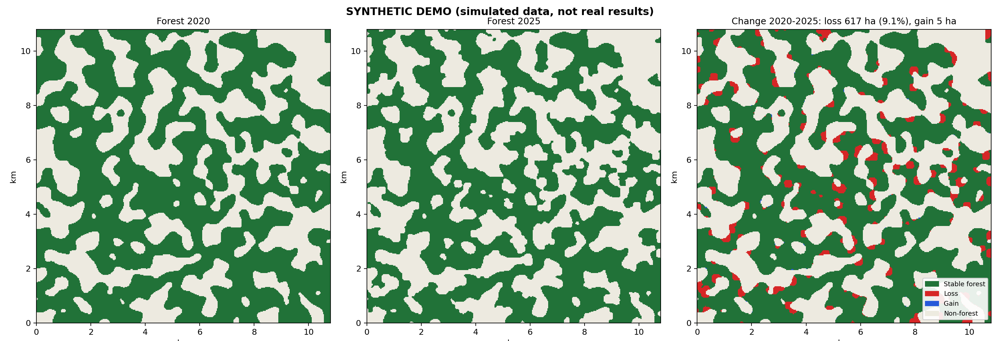
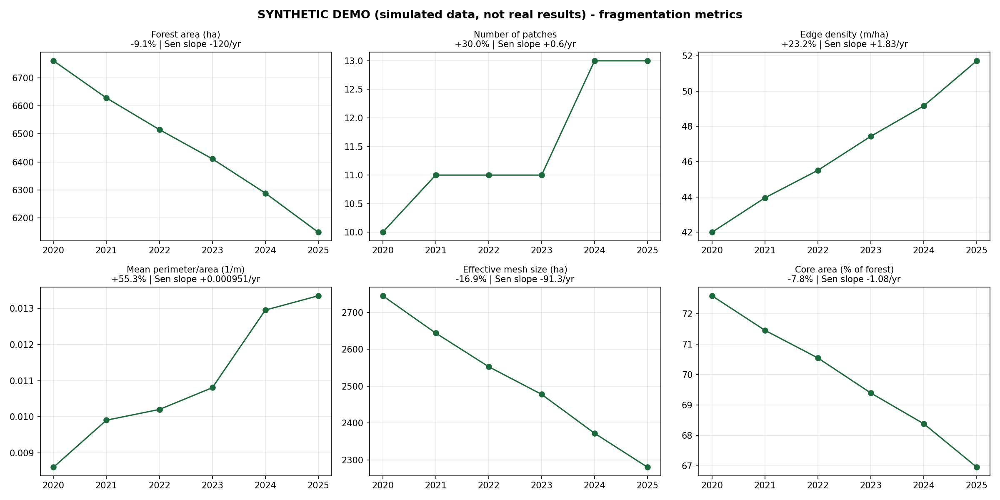

# Quantifying Forest Habitat Fragmentation — Western Ghats



A presentation-ready repository for reproducible mapping and analysis of forest fragmentation using open satellite data (Sentinel‑2, Random Forest classification, landscape metrics). This README is structured to serve as a professional project landing page and a concise methods + results summary for slides.

---

Table of contents
- Highlights
- One-line summary
- Key figures (demo)
- Research objectives
- Methods (concise)
- Study areas & data
- Outputs & how to interpret them
- Quick reproducible run (minimal)
- Validation & limitations
- Reproducibility, citation, contact

---

Highlights
- Reproducible pipeline to map forest/non-forest (2020–2025) and compute fragmentation metrics at landscape scale.
- Designed for robust inference: spatial-block CV, sensitivity analysis and independent loss validation against Hansen.
- Outputs: georeferenced maps, summary tables, per-site reports and publication-ready figures.

One-line summary
Map forest extent and quantify fragmentation trends (edge, P/A, core-area share, effective mesh size) with an open-data, reproducible workflow and automated reporting.

---

Key figures (demo outputs)

Figure — Example change map (synthetic demo):


Figure — Example fragmentation trends (synthetic demo):



*These synthetic images illustrate pipeline outputs. Replace with site-specific results for presentations.*

---

Research objectives
- RQ1: Do fragmentation metrics show directional change between 2020 and 2025 in our study sites?
- RQ2: Is change dominated by area loss or by spatial reconfiguration (splitting, perforation)?
- RQ3: How sensitive are findings to processing choices (minimum patch size, smoothing, temporal window)?

Working hypothesis: fragmentation indicators increase while connectivity measures decrease even when total forest area changes are modest.

---

Methods (concise, for slides)
- Inputs: Sentinel‑2 L2A, Copernicus DEM (GLO‑30), ESA WorldCover (label transfer), Hansen Global Forest Change (validation).
- Processing steps (automated):
  1. Annual dry-season composites (1 Jan–30 Apr), cloud masking and temporal aggregation.
  2. Feature extraction: spectral bands, NDVI/NDWI/NBR/NDMI, temporal NDVI sd, local texture, elevation and slope (~17 features).
  3. Labels: WorldCover tree class (border erosion + NDVI filter) used to train Random Forest (200 trees).
  4. Post-processing: smoothing, patch-size filtering, hole-filling; binary forest maps produced per year.
  5. Compute landscape metrics (patch count, mean P/A, shape index, edge density, core-area share at 100 m, effective mesh size).
  6. Trend estimation: percent change, Theil–Sen slope, Kendall τ; sensitivity across parameter grid.

For slide decks: use Methods → One figure per bullet to visualise pipeline and metrics flow.

---

Study areas & data
- Pre-configured sites: Valparai / Anamalai Plateau (`configs/valparai.yaml`) and Kodagu / Coorg (`configs/kodagu.yaml`).
- Data are open and free; no account required. See code in `src/ffa/data.py` for exact STAC endpoints and caching.

---

Outputs & interpretation (presentation notes)
- outputs/<site>/figures/fig1_forest_change.png — first vs last year + loss/gain map. Use as a headline slide.
- outputs/<site>/figures/fig3_fragmentation_trends.png — time-series of metrics. Use as main evidence slide with slope and % change annotated.
- outputs/<site>/tables/metrics_*.csv — include effect sizes and trend statistics in a table slide.
- outputs/<site>/rasters/forest_YYYY.tif — use in QGIS for zoomed-in visuals.

Presentation tip: show maps, then metrics, then sensitivity table (which demonstrates robustness) — it tells a defensible story.

---

Quick reproducible run (minimal)

1. Clone and prepare environment:
```bash
git clone https://github.com/sejalpandey30/forest-fragmentation
cd forest-fragmentation
python -m venv .venv && source .venv/bin/activate    # macOS/Linux
# Windows: .venv\Scripts\activate
pip install -r requirements.txt
```
2. Run synthetic demo (lightweight, for slides):
```bash
python run.py demo
```
3. Run a fast test on a site (coarse resolution):
```bash
python run.py analyze --config configs/valparai.yaml --res 60
```
4. For publication-ready maps, run default resolution and collect `outputs/<site>/figures` and `results.md`.

---

Validation & limitations (short)
- Validation: spatial block CV (2 km blocks), label-transfer checks (2020 vs WorldCover 2020), change validation vs Hansen annual loss.
- Key limitations: plantation vs native forest confusion, label circularity from WorldCover, limited years (6) for trend inference, reduced edge detection at coarse resolution, and no field data in the repo.

---

Reproducibility, citation, contact
- Results are deterministic with the same inputs and seed; caches stored under `data/cache/`.
- Machine-readable citation: see `CITATION.cff`.
- License: MIT (code). Data are subject to their providers' terms (Copernicus/ESA/Hansen).

Contact & contribution
- Author: YOUR NAME — replace with full name, affiliation and ORCID for slides.
- For contributions: open an issue or PR; for major changes, add a short CONTRIBUTING.md.

---

Want this adapted into a single-slide summary or a one-page methods + results PDF for presentations? I can generate a compact Markdown slide (reveal.js or Quarto) or assemble the figures and results.md into a printable one-page summary. Tell me which format you prefer (e.g., PDF one-pager, reveal.js slide, or PowerPoint export).