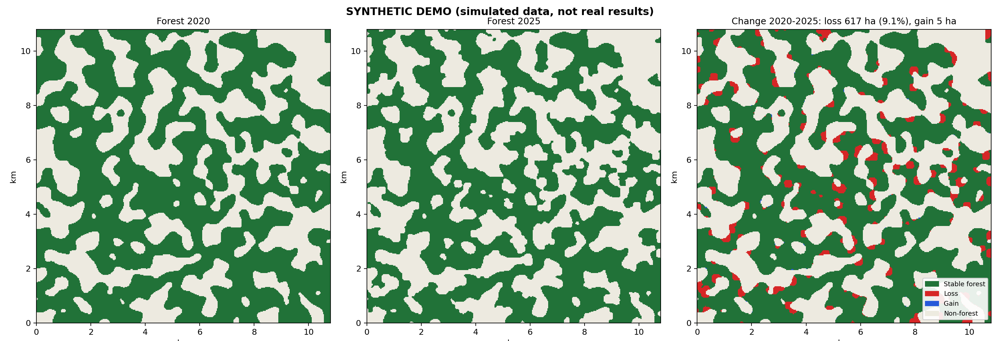
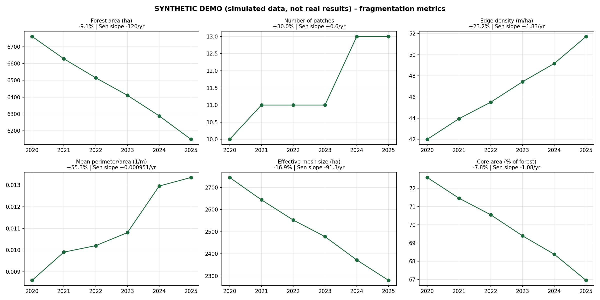

# Quantifying Forest Habitat Fragmentation in the Western Ghats with Open Satellite Data

*A reproducible remote-sensing pipeline (Sentinel-2 + Random Forest + landscape metrics), 2020-2025*

**Author:** YOUR NAME · **Contact:** your.email@example.com · **Status:** research prototype (v0.2)

[](https://github.com/YOUR-USERNAME/forest-fragmentation/actions)

## Abstract
Habitat fragmentation, the breaking of continuous forest into smaller, more isolated and more edge-exposed patches, is a major driver of biodiversity loss in the Western Ghats. This project provides an open, account-free pipeline that (i) classifies forest vs non-forest from annual dry-season Sentinel-2 composites with a Random Forest trained on cleaned ESA WorldCover labels, (ii) quantifies fragmentation each year with five landscape metrics (patch count, perimeter-to-area ratio, edge density, core-area share and effective mesh size), and (iii) tests whether the detected trends are robust to classification and post-processing choices. Accuracy is assessed with spatial block cross-validation and two external references (ESA WorldCover 2020 and Hansen Global Forest Change). All results are regenerated by one command.

## Research questions
1. **RQ1:** Did forest edge density and perimeter-to-area ratio increase, and effective mesh size decrease, in the study landscapes between 2020 and 2025?
2. **RQ2:** Is the change driven mainly by *loss of area* or by *spatial reconfiguration* (splitting and perforation) of the remaining forest? Compare the change in forest area with the change in edge density, patch count and mesh size.
3. **RQ3:** How sensitive are these conclusions to the minimum patch size, smoothing and temporal filtering?

**Working hypothesis (H1):** edge density and perimeter-to-area ratio rise while core-area share and effective mesh size fall, even where total forest area changes little, because clearing is concentrated along existing edges and linear features.

## Study areas
| Site | Config | Setting |
|---|---|---|
| Valparai / Anamalai plateau (≈22 km box) | `configs/valparai.yaml` | rainforest fragments inside a tea-estate matrix |
| Kodagu (Coorg) (≈25 km box) | `configs/kodagu.yaml` | coffee agroforestry matrix, replication site |

Add a site by copying a config and changing `bbox`. Any area in the northern/eastern hemisphere works.

## Data (all open, no account or card)
| Layer | Source | Use |
|---|---|---|
| Sentinel-2 L2A, 10-20 m | AWS Earth Search STAC (Copernicus) | optical features |
| Copernicus DEM GLO-30 | AWS Earth Search STAC | elevation, slope |
| ESA WorldCover v200 (2021) / v100 (2020) | AWS Open Data | training labels / label-transfer check |
| Hansen Global Forest Change | Google Cloud public bucket | independent loss validation |

## Method
1. **Composites.** For each year, scenes from 1 Jan to 30 Apr (dry season, fewer monsoon clouds) with scene cloud cover below 40% are cloud-masked with the Scene Classification Layer and reduced to a per-pixel median. The L2A reflectance offset introduced in January 2022 is corrected so years are comparable.
2. **Features (17).** Nine bands; NDVI, NDWI, NBR, NDMI; temporal NDVI standard deviation (separates evergreen from seasonal vegetation); local NDVI texture; elevation and slope.
3. **Labels.** WorldCover tree cover (class 10) vs all other classes. To reduce label noise, border pixels are eroded away (mixed pixels) and "forest" pixels with dry-season NDVI below 0.35 are dropped. Optional hand-drawn polygons (`extra_labels`) override WorldCover, which is the recommended way to fix plantation confusion.
4. **Classifier.** Random Forest (Breiman 2001), 200 trees, class-balanced sample, trained on 2021 and applied to all years.
5. **Post-processing.** Probability map, 3x3 smoothing, removal of patches below 1 ha, filling of holes below 0.5 ha. Optional temporal median.
6. **Landscape metrics** (4-connected patches, landscape border not counted as edge):

| Metric | Definition | Fragmentation signal |
|---|---|---|
| Patch count | number of forest patches ≥ 1 ha | up |
| Perimeter/area | mean over patches of P/A (1/m) | up |
| Shape index | mean of 0.25·P/√A (1 = square) | up |
| Edge density | total patch perimeter / forest area (m/ha) | up |
| Core area | % of forest > 100 m from non-forest | down |
| Effective mesh size | Σaᵢ² / A_landscape (ha) (Jaeger 2000) | down |

7. **Trend statistics.** Percent change, Theil-Sen slope and Kendall's τ for each metric. With only six annual points the tests have low power, so effect sizes and the sensitivity analysis matter more than p-values.

## Validation design
- **Spatial block cross-validation** (2 km blocks, 5 folds) so test pixels are not neighbours of training pixels, which avoids the optimistic accuracy of random splits (Roberts et al. 2017).
- **Label-transfer check:** the 2020 map against WorldCover 2020, i.e. does a model trained on 2021 labels work in another year? (Same producer as the labels, so this is a consistency check, not ground truth.)
- **Change validation:** pixels classified as lost between the first and last year against Hansen annual loss. Hansen only maps stand-replacing loss, so low recall for subtle edge degradation is expected and should be reported, not hidden.
- **Sensitivity analysis:** 18 combinations of temporal window, smoothing and minimum patch size; `results.md` reports in how many the direction of change is unchanged.

## Quick start
```bash
git clone https://github.com/YOUR-USERNAME/forest-fragmentation && cd forest-fragmentation
python -m venv .venv && .venv\Scripts\activate        # Windows (Linux/macOS: source .venv/bin/activate)
pip install -r requirements.txt
pytest -q                                              # unit tests
python run.py demo                                     # offline synthetic demo, ~1 min
python run.py analyze --config configs/valparai.yaml --res 60   # fast trial on real data
python run.py analyze --config configs/valparai.yaml            # full run at 30 m
```
Composites are cached in `data/cache/`, so re-runs and parameter changes are fast.

### Outputs (written to `outputs/<site>/`)
| Path | Content |
|---|---|
| `figures/fig1_forest_change.png` | first year, last year and loss/gain map |
| `figures/fig2_forest_timeseries.png` | forest extent for every year |
| `figures/fig3_fragmentation_trends.png` | six metrics with % change and Sen slope |
| `figures/fig4_accuracy.png`, `fig5_feature_importance.png` | accuracy and feature importance |
| `tables/*.csv, *.json` | metrics, trend statistics, CV folds, sensitivity, validation, change accounting |
| `rasters/forest_YYYY.tif` | georeferenced binary maps for QGIS |
| `results.md` | auto-generated results summary (paste into the paper or README) |

## Results
> **Replace this section with your own run.** Run both sites, then copy the key numbers from `outputs/<site>/results.md` and embed `fig1` and `fig3`. State the accuracy figures, the Hansen precision/recall, and whether H1 is supported, partly supported or rejected.

### Pipeline demonstration (SYNTHETIC data)
The figures below come from `python run.py demo`, a simulated landscape with known truth. They only show what the outputs look like. They are **not** findings about the Western Ghats.




## Limitations and threats to validity
- **Plantations.** Tea shade trees, coffee, rubber and eucalyptus can be classified as forest, and WorldCover does not separate native forest from tree plantations. Add hand-drawn polygons for plantations (`extra_labels`) or report results as "tree cover".
- **Label transfer.** Labels come from 2021 and are applied to other years. Spectral drift (sensor, phenology, residual cloud) can create artificial change; the 2020 check and the Hansen comparison are partial safeguards.
- **Resolution.** 30 m pixels miss narrow roads and trails, so edge density is a lower bound. Try `--res 10` on small areas.
- **Label circularity.** WorldCover is itself a satellite classification, so the model partly learns its errors.
- **Small sample of years.** Six annual maps give weak trend tests. Treat single-year jumps as noise.
- **Boundary effects.** Metrics are computed inside a finite window, so patches cut by the window edge are truncated.
- **No field data.** A stronger study would add field plots or high-resolution imagery for an independent accuracy assessment following Olofsson et al. (2014).

## Repository structure
```
src/ffa/        data.py (open-data access) · model.py · postprocess.py · metrics.py · validation.py
                pipeline.py · report.py · demo.py · cli.py
configs/        one YAML per site
tests/          unit tests for metrics, model, post-processing and the end-to-end demo
docs/figures/   synthetic-demo figures used above
run.py          launcher (python run.py demo | analyze)
```

## Extending this work
- Add native-forest vs plantation separation with hand labels or phenology features.
- Add more sites and test H1 across the Western Ghats, or add a landscape-level driver analysis (roads, protected-area boundaries).
- Use deep segmentation (U-Net) at 10 m and compare against the Random Forest baseline.
- Link fragmentation metrics with species data, for example bird or primate occurrence, to connect habitat structure to ecological outcomes.

## References
- Breiman, L. (2001). Random forests. *Machine Learning* 45, 5-32.
- Hansen, M. C. et al. (2013). High-resolution global maps of 21st-century forest cover change. *Science* 342, 850-853.
- Jaeger, J. A. G. (2000). Landscape division, splitting index, and effective mesh size. *Landscape Ecology* 15, 115-130.
- McGarigal, K. & Marks, B. J. (1995). *FRAGSTATS: spatial pattern analysis program for quantifying landscape structure.* USDA Forest Service GTR PNW-351.
- Olofsson, P. et al. (2014). Good practices for estimating area and assessing accuracy of land change. *Remote Sensing of Environment* 148, 42-57.
- Roberts, D. R. et al. (2017). Cross-validation strategies for data with temporal, spatial, hierarchical, or phylogenetic structure. *Ecography* 40, 913-929.
- Zanaga, D. et al. (2022). ESA WorldCover 10 m 2021 v200. Zenodo.

## License and data terms
Code: MIT. Sentinel-2 and Copernicus DEM data are free under Copernicus terms; ESA WorldCover and Hansen data are CC BY 4.0, so please attribute them.
# forest-fragmentation

